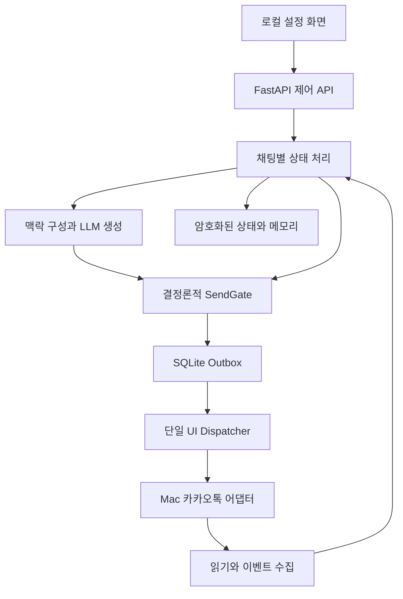

# KakaoReply 기술 아키텍처

- 문서 상태: Codex 구현을 위한 규범적 설계입니다. 아직 구현·실기기 검증 완료를 뜻하지 않습니다.
- 기준일: 2026-11-20입니다. `PRODUCT_SPEC.md`, 루트 `AGENTS.md`, 실제 JSON 스키마와 함께 적용합니다.
- 목표: 지정한 1:1 채팅에서 본인 말투·확인된 맥락·시간 정책을 반영해 자동 답장을 수행합니다.
- 실전송까지 구현하되, 개발 기본값은 `transport=mock`, `mode=off`, `live_send_enabled=false`입니다.
- 예제 데이터·테스트는 합성 대화로 수행합니다. 개인 대화나 카카오 인증 정보를 저장소에 넣지 않습니다.

## 1. 구성 요소와 실행 환경

| 구성 | 선택 | 책임 |
| --- | --- | --- |
| 실행기 | Python 3.12 이상, asyncio | 이벤트 처리, 예약, 생성, 전송 제어 |
| 로컬 API | FastAPI, 단일 프로세스 | 설정·상태·초안·검증 결과 제공 |
| 화면 | React, TypeScript, Vite | 한국어 설정·대시보드·대화 검토 화면 |
| 저장소 | SQLite, 버전 관리 마이그레이션 | 설정, 사건 기록, 예약, outbox, 암호화 데이터 |
| 카카오 연결 | mock / kmsg_mcp / kmsg_cli | 동일한 어댑터 계약으로 읽기·발송 제공 |
| LLM | 교체 가능한 provider 인터페이스 | 구조화된 답장 후보 생성, 직접 전송 권한 없음 |
| 비밀 관리 | macOS Keychain + 앱 계층 AEAD | API 키·암호화 키, 민감 컬럼 보호 |
| 배포 단위 | 로그인된 Mac 사용자 세션의 로컬 앱 | 실제 카카오톡 UI에 접근하는 실행 위치 |

버전은 구현 시 공식 문서와 실제 호환성을 확인해 lockfile에 고정합니다. `latest`만 적고 재현성을 생략하지 않습니다.
웹 화면은 우선 로컬에서 제공하고, 네이티브 메뉴바·앱 래퍼는 후속 단계로 둡니다.
서버·컨테이너·K3s에 UI 어댑터를 옮겨 Mac 카카오톡을 직접 제어할 수 있다고 가정하지 않습니다.
Mac 이외 환경에서는 합성 데이터 기반 mock 실행과 계약 테스트를 제공할 수 있습니다.

## 2. 구성 관계



화면과 LLM은 `kmsg` 전송 함수를 직접 호출하지 않습니다. 모든 실전송은 `SendGate`와 outbox를 통과합니다.
작업자가 여러 명이어도 실제 앱 실행기는 한 프로세스·한 UI dispatcher로 유지합니다.
개발 시 FastAPI reload나 복수 worker로 실행기가 중복 시작되지 않도록 API와 runtime 생명주기를 명시합니다.

## 3. 권장 모듈 경계

| 모듈 | 소유하는 책임 | 하지 않는 작업 |
| --- | --- | --- |
| `domain/` | 자료형, 정책, 상태 전이, 이유 코드 | UI 제어, 네트워크 요청 |
| `adapters/kakao/` | 원본 스키마 검증, 연결 기능 탐지 | 대상 선택의 임의 변경 |
| `ingestion/` | 순서·신규성·발신자 신뢰도, 중복 관측 | 본문만으로 영구 메시지 ID 추측 |
| `runtime/` | actor, clock, 예약, epoch, 시작·중지 | LLM에 발송 판단 전부 위임 |
| `generation/` | context budget, provider, JSON 검증 | shell·파일·다른 채팅 접근 |
| `memory/` | 말투 예시, 사실, 출처, 만료·삭제 | 봇 출력을 본인 원문으로 재학습 |
| `delivery/` | SendGate, outbox, 결과 재확인 | 불확실 발송 자동 재시도 |
| `storage/` | transaction, migration, 암호화 | 평문 민감 컬럼 fallback |
| `api/` | 인증된 로컬 제어와 상태 조회 | 원문을 액세스 로그에 출력 |
| `ui/` | 설정, 초안, 진행 상태, 즉시 중지 | 실행기 내부 구현을 사용자에게 강요 |

의존성 방향은 API/어댑터 → application 서비스 → domain입니다. domain 테스트는 Mac이나 API 키 없이 실행합니다.

## 4. 실행 모드와 명시적 자동 세션

| 모드 | 읽기·판단 | 후보 생성 | 실제 전송 |
| --- | --- | --- | --- |
| `off` | 상태 점검과 사용자가 요청한 검증만 | 예약 생성 안 함 | 금지 |
| `draft` | 지정한 범위에서 수행 | 허용 | 금지 |
| `auto` | 자동 세션 범위에서 수행 | 허용 | 모든 전송 조건을 만족할 때 허용 |

`transport=mock`이면 어떤 모드에서도 실제 카카오톡을 호출하지 않습니다.
`live_send_enabled=false`이면 `mode=auto`여도 외부 전송 어댑터 호출은 0회여야 합니다.
운영자는 대상·시간대·횟수 한도를 확인하고 자동 세션을 시작합니다. 같은 범위의 정상 응답마다 재승인을 요구하지 않습니다.
`active_windows=[]`는 항상 작동이라는 뜻이 아니라 자동 발송을 허용하는 시간이 없다는 뜻입니다.
범위 변경은 기존 작업 epoch를 무효화하고 새 설정으로 재검증합니다. 숨겨진 전체 채팅방 모드는 구현하지 않습니다.
자동 전송 문구에는 엔진이 항상 `— 부재중 AI 답장`을 붙입니다. `disclosure_mode=per_message`는 v1 고정입니다.
LLM 출력이나 상대 메시지로 표시를 제거할 수 없습니다. 사용자를 은밀하게 가장하는 모드는 제공하지 않습니다.

## 5. 기본 설정 계약

아래 시간값은 모두 초이며, 스키마 필드명은 표의 이름을 그대로 사용합니다.

| 키 | 기본값 | 의미 |
| --- | --- | --- |
| `timezone` | `Asia/Seoul` | 허용 시간대와 일별 한도 평가 기준 |
| `mode` / `transport` | `off` / `mock` | 개발 시작 상태 |
| `live_send_enabled` | `false` | 실전송 허용 여부 |
| `active_windows` | `[]` | 운영자가 정의할 허용 시간 구간 |
| `reply_delay` / `settle` | `600` / `20` | 최초 미응답 대기 / 추가 메시지 묶기 |
| `human_cooldown` / `poll` | `900` / `5` | 본인 대화 이후 휴지 / 관측 주기 |
| `max_incoming_age` | `1800` | 자동 응답 대상으로 허용할 최대 입력 나이 |
| `max_autoreplies_session` / `session_gap` | `3` / `1800` | 연속 자동 응답 한도 / 세션 구분 간격 |
| `max_per_hour` / `max_per_day` | `6` / `20` | 실전송 시도 횟수 상한 |
| `max_chars` | `240` | 표시 문구를 포함한 최종 메시지 길이 상한 |
| `llm_timeout` / `llm_retries` | `30` / `1` | 생성 요청 제한 시간 / 추가 재시도 횟수 |

`llm_retries=1`은 최초 요청 이후 최대 한 번의 추가 생성 시도입니다. 전송 재시도를 뜻하지 않습니다.
`provider`, `storage`만 중첩 설정으로 두며 민감 값은 Keychain 참조로 저장합니다.
길이는 NFC 정규화 후 Unicode code point 수로 평가합니다. 프런트엔드와 백엔드에 같은 사례를 적용합니다.
최종 문구가 길면 발송 전에 생성 후보를 축약하거나 보류합니다. 자동 표시를 잘라 길이를 맞추지 않습니다.

## 6. 핵심 자료 계약

모든 내부 ID는 앱에서 발급한 식별자입니다. 카카오 서버의 영구 ID라는 의미를 부여하지 않습니다.

| 자료형 | 주요 필드 | 불변 조건 |
| --- | --- | --- |
| `ConversationBinding` | `binding_id`, `binding_revision`, `upstream_chat_id`, 암호화 이름 | 특정 1:1 방을 운영자가 검증함 |
| `NormalizedMessage` | `event_id`, `binding_id`, `origin`, `observed_at`, `source_time`, `confidence` | 원본 메타데이터 누락을 보존함 |
| `ConversationState` | `conversation_epoch`, 미응답 묶음, cooldown, `auto_session_id` | 채팅별 단일 actor가 갱신함 |
| `ReplyJob` | `reply_job_id`, `candidate_id`, `due_at`, 상태, snapshot digest | 하나의 입력 묶음에 하나의 활성 작업 |
| `OutboxAttempt` | 작업 ID, `dispatch_started_at`, 어댑터 버전, 결과 | 작업당 자동 외부 호출 최대 1회 |
| `MemoryFact` | subject, fact, 출처 event IDs, 확인 상태, 유효기간 | 추측과 확인된 사실을 구별함 |
| `StyleExample` | 본인 문장, 출처, 작성 유형, 검토 상태 | 자동 생성 원문은 기본 제외함 |
| `AuditEvent` | 이유 코드, 무작위 내부 ID, 시각, 상태 전이 | 대화 본문·이름·API 키를 포함하지 않음 |

`origin`은 `partner`, `owner`, `bot`, `system`, `unknown` 중 하나입니다.
`unknown`을 이름이나 문장 습관만으로 owner/partner로 승격하지 않습니다. 자동 발송은 보류합니다.
`source_time`과 `observed_at`을 구분하고, 원본 시각을 알 수 없는데 관측 시각으로 바꿔 쓰지 않습니다.
출처가 검증된 신규성과 시각이 없으면 입력 나이 제한을 통과했다고 표시하지 않습니다.
`binding_revision`, `settings_revision`, `conversation_epoch`, `monitor_session_id`는 엔진 envelope에 보관합니다.

## 7. LLM 요청·응답 계약

모델 입력은 지침, 본인이 승인한 말투 규칙, 제한된 최근 대화, 유효한 사실, 현재 상태를 구분해 구성합니다.
대화와 가져온 파일의 내용은 처리할 데이터이며 상위 실행 지침이 아닙니다.
다른 채팅, 파일, shell, 자격 증명, 전송 도구는 모델에 노출하지 않습니다.
응답 JSON의 필드는 아래 네 개로 고정합니다. 다른 필드는 schema validation에서 거부합니다.

```json
{
  "action": "reply",
  "reply_text": "생성된 답장 후보",
  "reason_codes": ["ROUTINE_REPLY"],
  "used_fact_ids": []
}
```

`action`은 `reply`, `hold`, `notify_owner`, `no_reply` 중 하나입니다.
수신자, 자동 허용 여부, epoch, 전송 옵션은 모델이 결정하는 필드가 아닙니다.
`reply`의 본문이 비어 있거나 비정상 형식이면 발송하지 않습니다. 다른 action은 대화창 발송을 수행하지 않습니다.
`used_fact_ids`는 현재 context에 제공한 ID 집합의 부분집합이어야 합니다.
`notify_owner`는 로컬 화면·로컬 알림을 뜻하며 다른 연락처로 메시지를 보내는 기능이 아닙니다.
provider 오류와 잘못된 JSON은 정해진 생성 재시도 한도 내에서 처리하고, 이후 보류 이유를 표시합니다.

## 8. 미응답과 시간 정책

`first_unanswered_at`은 현재 해결되지 않은 묶음의 첫 상대 메시지, `last_partner_at`은 마지막 상대 메시지입니다.

```text
due_at = max(
  first_unanswered_at + reply_delay,
  last_partner_at + settle,
  human_cooldown_until
)
```

새 상대 메시지는 첫 시각을 덮어쓰지 않고 settle과 context를 갱신합니다.
본인이 답하면 그보다 앞선 미응답 묶음을 해결 처리하고 예약·생성 후보를 취소합니다.
봇 echo는 본인 수동 답장으로 처리하지 않습니다. 식별이 불확실하면 재생성·추가 발송을 보류합니다.
`CONFIRMED_LOCAL`이 되면 후보가 실제로 포함한 상대 입력 범위만 해결 처리하고 그 묶음의 최초 미응답 시각을 비웁니다. 후보에 포함되지 않은 새 상대 메시지는 새 묶음과 새 대기시간으로 처리합니다. 봇 답장은 `human_cooldown`을 늘리거나 세션·시간당·일일 한도를 초기화하지 않습니다.
최대 입력 나이는 생성 전과 발송 직전에 각각 검사합니다. 초과하면 `SKIPPED_POLICY`로 종료합니다.
긴 대화 묶음이나 조용한 시간 때문에 오래 기다렸다고 강제 발송하지 않습니다.
허용 구간은 시작 포함·종료 제외입니다. 자정을 넘는 구간의 요일은 시작일을 기준으로 평가합니다.
한 시간 한도는 현재 시각에서 이전 3,600초의 rolling window로 계산합니다. 일별 한도는 설정 타임존의 날짜를 씁니다.
세션 간격은 마지막 관련 대화 활동 이후 `session_gap`입니다. 재시작·모드 전환으로 한도를 초기화하지 않습니다.
UTC로 영속화하되 실행 중 타이머는 단조 시계를 사용합니다. 재시작·절전 복귀 시 DB와 최신 대화를 재평가합니다.
허용 구간 시작 시 과거 묶음을 일괄 전송하지 않습니다. 현재성·수동 해결 여부를 다시 확인합니다.

## 9. 상태 전이

| 상태 | 진입 조건 | 허용 후속 상태 |
| --- | --- | --- |
| `PENDING` | 검증된 상대 신규 입력을 묶음으로 저장 | GENERATING 또는 취소·보류 상태 |
| `GENERATING` | due와 정책을 통과하고 context 고정 | READY, CANCELED_HUMAN, CANCELED_STALE, SKIPPED_POLICY, FAILED_BEFORE_DISPATCH |
| `READY` | schema와 내용 검증을 통과함 | DISPATCHING 또는 취소·보류 상태 |
| `DISPATCHING` | 발송 의도를 DB에 기록한 뒤 외부 호출 시작 | CONFIRMED_LOCAL 또는 DELIVERY_UNKNOWN |
| `CONFIRMED_LOCAL` | 로컬 전송 동작과 대응 echo를 확인 | 종료 |
| `CANCELED_HUMAN` | 본인의 선행 답장을 확인 | 종료 |
| `CANCELED_STALE` | context·설정·대상·모드가 변경 | 종료; 필요하면 새 작업 생성 |
| `SKIPPED_POLICY` | 시간·한도·현재성·대상 정책 불충족 | 종료 |
| `FAILED_BEFORE_DISPATCH` | 외부 호출 시작 전 확정적 실패 | 종료 또는 새 사전 단계 작업 |
| `DELIVERY_UNKNOWN` | 외부 호출 이후 결과를 확정할 수 없음 | 사용자 확인에 의한 reconciliation만 |

종료 작업을 되살리지 않습니다. 다시 필요한 응답은 새 작업 ID로 만들고 기존 작업과 연결합니다.
`DELIVERY_UNKNOWN` 뒤 같은 입력에 새 작업을 자동 생성해 우회 재전송하지 않습니다.

## 10. SendGate와 동시성

SendGate는 다음을 한 번의 정책 판단으로 확인하고, 실패한 이유 코드를 남깁니다.

1. 유효한 자동 세션, `mode=auto`, 실전송 허용, 허용 시간대가 성립해야 합니다.
2. 현재 binding과 대상 이름·버전이 검증 당시와 일치해야 합니다.
3. 최신 스냅샷에 본인 답장이나 신뢰도 저하·관측 공백이 없어야 합니다.
4. 생성 당시 epoch·설정 revision·binding revision이 현재 값과 같아야 합니다.
5. 입력 나이·미응답 기준·cooldown·횟수 한도를 만족해야 합니다.
6. 후보의 action·길이·사실 근거·고정 자동 표시를 검증해야 합니다.
7. 같은 작업의 기존 전송 시도와 불확실 전송이 없어야 합니다.

채팅별 actor 외에 **프로세스 전체 UI dispatcher**를 둡니다. 서로 다른 방의 UI 작업도 겹치지 않게 합니다.
SQLite transaction과 작업 ID unique constraint로 outbox 선점을 보장하고 OS 수준 단일 실행 lock을 둡니다.
모든 본인 메시지·새 입력·설정 변경·중지 이벤트는 epoch를 증가시킵니다. 오래된 모델 결과는 폐기합니다.
외부 UI 호출과 휴대폰 답장은 하나의 원자적 transaction이 아닙니다. 극히 짧은 경쟁 구간을 완전히 제거했다고 주장하지 않습니다.
중지 버튼은 아직 시작하지 않은 작업을 취소합니다. 이미 전송 동작이 시작된 경우 결과를 확인해 그대로 표시합니다.

## 11. Outbox와 전송 결과

`DISPATCHING`을 먼저 영속화하고 외부 호출을 수행합니다. 이 기록 이후 crash가 나면 자동 재전송하지 않습니다.
호출 전 crash로 전송이 누락될 가능성을 받아들이고, 중복 전송보다 운영자의 확인을 우선합니다.
외부 호출 이후 timeout·파싱 실패·프로세스 종료는 기본적으로 `DELIVERY_UNKNOWN`입니다.
카카오톡 창에서 대응 메시지를 관측한 사실은 상대의 수신·읽음 확인이 아닙니다.
`CONFIRMED_LOCAL`을 화면에 “상대가 읽음”으로 번역하지 않습니다.
전송 결과가 불확실하면 해당 binding의 자동 발송을 정지하고 로컬 확인 작업을 생성합니다.
한도는 성공한 메시지만이 아니라 실제 전송 동작을 시작한 시도도 계산합니다. 불확실 시도로 한도를 우회할 수 없습니다.
`exactly-once`를 보장하지 않습니다. 앱 내부의 중복 방지와 작업당 최대 한 번의 자동 호출을 보장 범위로 문서화합니다.

## 12. 말투·메모리·평가

본인 직접 작성, 본인이 수정 후 채택, 봇 자동 생성, 인용·전달, 작성자 불명의 출처를 별도 표기합니다.
기본 스타일 자료에는 검증된 본인 직접 작성만 포함합니다. 본인이 채택한 수정은 별도의 승인된 예시로 추가합니다.
이름·관계·일정·현재 위치·감정을 문체 통계로부터 추측해 사실로 만들지 않습니다.
모델이 추출한 사실은 candidate로 저장하고 출처·주체·확인 상태·유효시간을 유지합니다.
현재 상태가 만료되면 context에서 제외합니다. 상충하는 약속이나 관계 관련 판단은 임의로 확정하지 않습니다.
저장한 사실을 사용자가 수정·삭제할 수 있어야 합니다. 원문 삭제와 연결된 요약·예시·검색 캐시 삭제를 함께 처리합니다.
검색·유사 예시 선택은 v1에서 복호화한 제한된 자료를 메모리 안에서 처리합니다. 원문 평문 FTS·벡터 DB는 만들지 않습니다.
대화 일부는 평가용으로 분리하여 예시에 넣지 않습니다. 말투, 맥락 적합성, 사실 오류, 불필요한 약속을 따로 평가합니다.
점수가 좋다는 이유로 불확실 발신자나 전송 정책을 무시하지 않습니다.

## 13. 저장·암호화·보존

대화 본문, 생성문, 사실·스타일 메모리, 채팅방 이름은 SQLite 민감 컬럼에 앱 계층 AEAD로 암호화합니다.
키는 macOS Keychain에 저장하며 DB에는 key reference·버전만 둡니다. AAD는 테이블·행 ID·schema version을 포함합니다.
Keychain이나 암호화가 실패하면 실데이터 처리를 중단합니다. 평문 fallback을 두지 않습니다.
Linux mock은 합성 자료에 한해 임시 메모리 키를 허용합니다. 이를 실데이터·Mac 배포 설정으로 확장하지 않습니다.
원문 및 이를 포함하는 생성·파생 자료의 기본 보존은 7일, 본문 없는 감사 메타데이터는 30일입니다.
선택한 장기 기억은 사용자가 명시적으로 보존한 독립 기록으로 관리하고 원문 출처 삭제 상태를 표시합니다.
SQLite WAL·백업에도 민감 평문이 기록되지 않도록 암호화 위치를 repository 경계로 고정합니다.
로그·오류·HTTP trace에 본문·이름·키를 출력하지 않습니다. 중복 비교 digest는 애플리케이션 키로 HMAC 처리합니다.
`kmsg` 자체 인증 저장소는 앱 Keychain 보장과 별개입니다. 앱이 그 파일이나 카카오 비밀번호를 수집·복제하지 않습니다.

## 14. 로컬 API와 화면 계약 제안

API는 기본 `127.0.0.1:8765`에만 bind하고, 로컬 세션 token·허용 Origin·CSRF 방어를 적용합니다.
다른 웹사이트가 loopback API에 요청해 자동 모드를 켤 수 없어야 합니다. wildcard CORS를 사용하지 않습니다.

| API 제안 | 동작 |
| --- | --- |
| `GET /api/health` | 비밀 없는 버전·준비 상태 |
| `GET /api/runtime` | 모드, pause 이유, 관측 시각, 카운터 |
| `GET/PUT /api/settings` | revision 기반 설정 조회·수정 |
| `POST /api/bindings/verify` | 사용자가 선택한 대상 검증 |
| `POST /api/runtime/start` | 지정 범위의 자동 또는 초안 세션 시작 |
| `POST /api/runtime/pause` | 현재 작업 무효화·향후 전송 중지 |
| `GET /api/jobs` | 작업·후보·이유 조회, 본문은 명시적 상세 요청에서 제공 |
| `POST /api/jobs/{id}/reconcile` | 불확실 결과에 대한 사용자 확인 기록 |
| `GET /api/events` | SSE 상태 이벤트; 기본 payload에 원문 없음 |

SSE를 우선하고 웹소켓은 필요한 경우에만 추가합니다. 이벤트 누락 후에는 현재 상태를 다시 조회합니다.
화면은 대상 설정, 시간·한도, 현재 상태, 말투·기억, 생성·전송 내역, 연결 진단으로 구성합니다.
설정 충돌은 HTTP 409와 현재 revision으로 알리고, 오래된 화면이 새 설정을 덮어쓰지 않게 합니다.

## 15. 구현 순서와 검증 경계

1. 순수 domain·가상 clock·mock transport·합성 fixture·로컬 UI를 완성합니다.
2. 동일 계약으로 CLI/MCP 어댑터를 연결하고 실제 지원 capability를 기록합니다.
3. Mac에서 읽기·대상 식별·휴대폰 수동 답장 감지를 별도 검증합니다.
4. 명시적으로 지정한 테스트 채팅방에서 전송 전 검사와 실제 결과 확인을 수행합니다.
5. 자동 세션 운영·중지·restart·sleep 복귀·오류 reconciliation을 점검합니다.

mock E2E 성공을 카카오 실연동 성공으로 보고하지 않습니다. 미검증 항목을 release 보고서에 그대로 남깁니다.
성능 측정은 텍스트 내용 없이 관측→작업→생성→검사→전송 단계의 지연과 실패 코드로 수행합니다.

## 16. 근거와 설계 구분

- [kmsg README](https://github.com/channprj/kmsg/blob/main/README.en.md): Mac 요구사항과 CLI/MCP 제공 기능을 확인합니다.
- [kmsg 사용 문서](https://github.com/channprj/kmsg/blob/main/USAGE.md): 입력·출력·옵션·주의할 동작을 확인합니다.
- [kmsg 아키텍처](https://github.com/channprj/kmsg/blob/main/ARCHITECTURE.md): UI 기반 접근과 로컬 합성 ID의 성격을 확인합니다.
- 위 문서는 kmsg 작성자의 자료입니다. KakaoReply의 상태 기계·시간·암호화·API 계약은 본 프로젝트의 설계입니다.
- 실제 구현 시 설치한 버전의 도움말·MCP schema를 함께 확인하고, 차이가 있으면 ADR과 어댑터 테스트를 갱신합니다.
